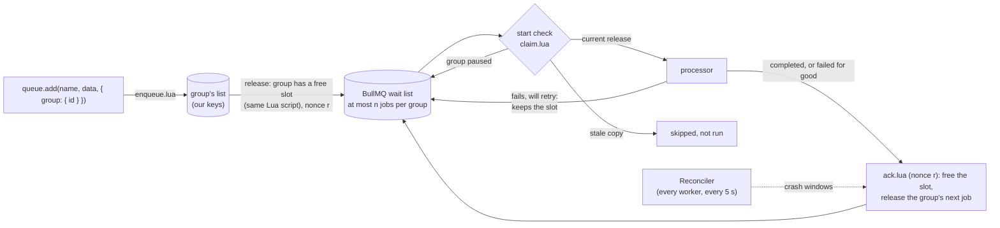

# bullmq-groups

Per-group FIFO and fairness for open-source BullMQ: an alternative to BullMQ Pro's groups. Jobs of one group (a tenant, an account, a user) start in the order they were added, at most `n` at a time, and groups take turns, so one busy group can't starve the others.

- **Pro-shaped API.** The inputs and outputs are the same as BullMQ Pro's groups: `queue.add(name, data, { group: { id } })`, `{ group: { concurrency } }` on the worker, `pauseGroup`, `getGroupJobs` and the rest. Code written for one runs on the other with a change of imports. See [Compared with BullMQ Pro](#compared-with-bullmq-pro).
- **NestJS module.** `bullmq-groups/nestjs` has the same API as `@nestjs/bullmq`: `BullModule.forRoot`, `registerQueue`, `@Processor`, `WorkerHost`, `@InjectQueue`, `@OnWorkerEvent`. An app moves over by changing an import path. See [NestJS](#nestjs).

**Status: proof of concept (0.1.0), not yet run in production.** The test suite passes on BullMQ 5.40.0 to 6.3.15. This README covers the API, the design, the guarantees and their limits, and how to run things.

```ts
import { GroupQueue, GroupWorker } from 'bullmq-groups';

const connection = { url: process.env.REDIS_URL, maxRetriesPerRequest: null };

// Producer. A GroupQueue is a BullMQ Queue; the group goes in the job options, as in BullMQ Pro.
const queue = new GroupQueue('account-sync', { connection });
const job = await queue.add('sync', { accountId }, {
  group: { id: String(accountId) },
  removeOnComplete: true,
  removeOnFail: true,
});
// job is a GroupJob (BullMQ's Job, like Pro's JobPro): job.id, job.data, job.opts.group, job.gid

// Worker. A GroupWorker is a BullMQ Worker; any BullMQ worker option, method and event works.
const worker = new GroupWorker('account-sync', async job => {
  await syncAccount(job.data.accountId); // job.gid === job.opts.group.id
}, {
  connection,
  concurrency: 12,               // BullMQ's: jobs per process, across all groups
  group: { concurrency: 1 },     // Pro's: jobs per group at once, across all workers
});

worker.on('stuck', s => logger.warn('job running too long', s)); // { jobId, groupId, state, ageMs }
```

A job added without `group` is a plain BullMQ job on the same queue, as with Pro.

### NestJS

Import from `bullmq-groups/nestjs` where you imported from `@nestjs/bullmq`. Nothing else changes: the module, decorators and injection tokens are `@nestjs/bullmq`'s own, as they are in BullMQ Pro's NestJS package.

```ts
// app.module.ts
import { BullModule } from 'bullmq-groups/nestjs';

@Module({
  imports: [BullModule.forRoot({ connection: { url: process.env.REDIS_URL, maxRetriesPerRequest: null } })],
})
export class AppModule {}

// account.module.ts
@Module({
  imports: [BullModule.registerQueue({ name: QueueNames.ACCOUNT_SYNC })],
  providers: [AccountSyncProcessor, AccountSyncService],
})
export class AccountModule {}

// account-sync.processor.ts
import { GroupJob, OnWorkerEvent, Processor, WorkerHost } from 'bullmq-groups/nestjs';

@Processor(QueueNames.ACCOUNT_SYNC, {
  concurrency: 12,
  group: { concurrency: 1 }, // one sync per account at a time; accounts take turns
  lockDuration: 120_000,
  stalledInterval: 60_000,
})
export class AccountSyncProcessor extends WorkerHost {
  async process(job: GroupJob<{ accountId: string }>): Promise<void> {
    await this.accountSyncService.sync(job.data.accountId);
  }

  @OnWorkerEvent('blocked') // the package's own worker events work here too
  onBlocked(groupId: string, jobId: string) {
    this.logger.warn(`account ${groupId} blocked by job ${jobId}`);
  }
}

// account-sync.service.ts
import { GroupQueue, InjectQueue } from 'bullmq-groups/nestjs';

@Injectable()
export class AccountSyncService {
  constructor(@InjectQueue(QueueNames.ACCOUNT_SYNC) private readonly queue: GroupQueue) {}

  addSync(accountId: string) {
    return this.queue.add('sync', { accountId }, { group: { id: accountId }, removeOnComplete: true });
  }
}
```

Moving an existing queue over:

1. Import `BullModule`, `Processor`, `WorkerHost`, `InjectQueue` and `OnWorkerEvent` from `bullmq-groups/nestjs` instead of `@nestjs/bullmq`. Type injected queues as `GroupQueue` and jobs as `GroupJob`.
2. Add `group: { id }` to the `add()` calls that should be grouped, for example with a tenant or user id. Other adds stay plain jobs.
3. Add `group: { concurrency: n }` to the queue's `@Processor` options, or leave it out for Pro's default (no per-group limit, groups take turns).
4. Give the queue a new name and let the old one drain: a plain worker must never take a grouped queue's jobs (see [Production settings](#production-settings)).
5. Alert on `getStats().oldestWaitingMs` and the `blocked`, `stuck` and `rejected` events (see [Observability](#observability)).

How it works: `@nestjs/bullmq` has two public hooks, `BullModule.queueClass` and `BullModule.workerClass`, there for BullMQ Pro. Importing this module points them at `GroupQueue` and `GroupWorker`, so every queue and processor in the app gets groups.
- A queue that never receives a grouped job behaves and costs exactly as before. Its worker opens no extra connection, and its only background work is one `EXISTS` every 5 s.
- `@InjectQueue`, `@QueueEventsListener`, `registerQueueAsync`, `forRootAsync` and bull-board keep working.

Two things to know:
- The hooks are global, so import `BullModule` from here in every module that registers queues. A queue registered before this file loads stays a plain `Queue`.
- `registerFlowProducer` still gives BullMQ's `FlowProducer`. Grouped jobs in flows are not supported.

Tested:
- the test suite on Nest 10.4 with `@nestjs/bullmq` 10.2.3 and BullMQ 5.40.0, 5.67.1 and 5.81.5, and with `@nestjs/bullmq` 11.0.5 on BullMQ 6.3.15 (older `@nestjs/bullmq` does not accept BullMQ 6);
- a scratch Nest app built from the packed tarball, on Nest 10.4 with `@nestjs/bullmq` 10.2.3 and on Nest 11.2 with `@nestjs/bullmq` 12.0.0. It runs grouped jobs end to end.

### Compared with BullMQ Pro

| BullMQ Pro | This package |
| --- | --- |
| `QueuePro`, `WorkerPro`, `JobPro` | `GroupQueue`, `GroupWorker`, `GroupJob`: subclasses of BullMQ's `Queue`, `Worker` and `Job` |
| `queue.add(name, data, { group: { id, priority, maxSize } })` returns a `JobPro` | Same, returns a `GroupJob` |
| `queue.addBulk([{ name, data, opts: { group } }])` returns `JobPro[]` | Same. `maxSize` is not supported in `addBulk`, as in Pro |
| `job.opts.group`, `job.gid` | Same. `job.opts.group.r` is an internal release nonce |
| `new WorkerPro(name, processor, { group: { concurrency } })`; unset means no per-group limit | Same, including the default: with no limit, a group's jobs run in parallel and start in order, and groups take turns |
| `pauseGroup`, `resumeGroup` return a `boolean` | Same |
| `setGroupConcurrency`, `getGroupConcurrency`, `removeGroupConcurrency` (`deleteGroupConcurrency`) | Same. `getGroupConcurrency` returns `Infinity` for no limit. `ttlSeconds` is not supported |
| `getGroups`, `getGroupsCount`, `getGroupStatus`, `getGroupsByStatus`, `getGroupsCountByStatus`, `GroupStatus` | Same shapes. `GroupStatus` adds `Blocked`; `Limited` never occurs |
| `getGroupJobs`, `getGroupJobsCount`, `getGroupsJobsCount`, `getGroupActiveCount`, `getCountsPerPriorityForGroup` | Same |
| `deleteGroup`, `deleteGroups`, `repairMaxedGroup`, `GroupMaxSizeExceededError` | Same |
| `@taskforcesh/nestjs-bullmq-pro` | `bullmq-groups/nestjs` |
| Group rate limits: `group.limit`, `rateLimitGroup`, `setGroupRateLimit`, `getGroupRateLimitTtl` | **Not supported.** `group.limit` throws |
| Batches and `groupAffinity`, observables, group meta, sandboxes-for-groups docs | **Not supported** (sandboxed processors do work) |
| Grouped jobs in flows, repeatable grouped jobs | **Not supported**: rejected at add |
| None | Only here: `failurePolicy: 'block'` with `retryBlockedGroup`, `skipBlockedGroup` and `getBlockedGroups`; `getStats`, `getLaggingGroups`, `getGroupCounts`, `getStuckJobs`; the events `stuck`, `blocked`, `repaired`, `skipped` and `rejected` |

Differences in behaviour:
- **Order through retries.** Here, a retrying job keeps its group's slot, so at group concurrency 1 nothing behind it starts. Pro lets later jobs overtake it.
- **Ids.** Group ids are stored as strings; numbers are converted. Generated job ids are strings like `g<process><time><counter>`, not BullMQ's numeric counter.
- **Counts.** `getJobCounts()`, `getWaiting()` and BullMQ's other getters count only jobs BullMQ holds. Jobs waiting in a group are counted by `getGroupsJobsCount()`, and found by `getJob()`, `getGroupJobs()` and `remove()`. Pro's groups also keep their jobs out of the wait list.

## How it works

Waiting jobs live in a Redis list per group, not in BullMQ. A job is handed to the queue's ordinary BullMQ wait list only when its group has a free slot. That means:

- BullMQ never holds more than `n` jobs of one group, where `n` is the group concurrency.
- BullMQ's FIFO wait list therefore serves groups round-robin. When a group's job finishes, the group's next job joins the back of the wait list, behind one job from every other busy group.
- With no per-group limit (Pro's default), a group keeps one released job waiting in BullMQ: its turn. When that job starts, the group's next job is released behind every other group's turn. Any number of a group's jobs can run at once, and they start in the order they were added.
- BullMQ's locks, retries, backoff, stalled-job recovery, events and metrics all work unchanged. `GroupQueue`, `GroupWorker` and `GroupJob` are subclasses of BullMQ's classes, and function and sandboxed processors both work.

Every release gets a **nonce** that travels with the BullMQ job (`job.opts.group.r`). The scripts that confirm or finish a job act only on the release they belong to. Before a processor runs, the worker's **start check** confirms the job is the release its group is waiting for. So a command resent after a reconnect, a late `Queue.add`, or an id reused after the job finished can't free a slot twice or run a stale copy.



Every change that can free capacity runs inside one Lua script, and so does the release: adding a job, finishing one, starting one (for a group with no limit), resuming a group, raising its concurrency, a delayed job coming due. Two workers can never release the same job or overfill a group.

The package uses BullMQ's public API (`Queue.add/addBulk/getJob`, `Job.retry/remove/moveToDelayed`, `Worker` events) plus three protected extension points:
- `Worker.callProcessJob`, for the start check;
- `Job.validateOptions`, to check options before a job is stored;
- the `Job` class getter, so queues and workers hand out `GroupJob`s.

Its scripts read one BullMQ key: a job's hash, for whether it exists and which nonce its options carry. The same 70 tests pass on BullMQ **5.40.0** (the oldest supported), **5.67.1**, **5.81.5** and **6.3.15** (latest).

## Why this design

Three designs were built and benchmarked (`bench/approaches/`).

| Design | FIFO per group | Fair across groups | What it costs at 1k+ groups | Verdict |
| --- | --- | --- | --- | --- |
| Queue per group: one BullMQ queue and a concurrency-1 worker per group | Yes | Yes | One worker and one blocking Redis connection per group, on every worker process. No global concurrency limit. Each idle queue leaves ~6 keys behind. It would also need group discovery and idle-worker cleanup. | Rejected |
| One queue, group index in Lua, release a job when its group has a slot (this package) | Yes, at group concurrency 1, also through retries | Round-robin by turns | 4 Redis connections per queue per worker process (BullMQ's 2 plus 2 of ours) once the queue has group jobs, against 2 for plain BullMQ; none extra before. Idle groups cost 0 keys. About 2.5x plain BullMQ's Redis CPU per job. | Built |
| One queue, push out-of-turn jobs back with `moveToDelayed` | Only at group concurrency 1 | Poor under skew: a big group's backlog clogs the queue | Every out-of-turn pick is a wasted fetch and re-delay. Per-group gate keys are never cleaned up. | Rejected |

Another option is to let the worker pick the next eligible group when it fetches a job. This package makes the same pick at release time instead. Picking at fetch time would mean replacing BullMQ's fetch script (`moveToActive`), which means forking BullMQ's Lua. Releasing at most `n` jobs per group into an unmodified BullMQ gives the same ordering and fairness, at two costs listed below: priority cannot reorder a job that was already released, and order at group concurrency `n` > 1 is only kept within a window of `n`.

## Edge cases

Each answer is covered by the tests named. `edge-cases` holds the rarer failure modes: commands resent after a reconnect, a late `Queue.add`, reused job ids, options BullMQ refuses, a Redis out-of-memory error while handing jobs to BullMQ, and races between the reconciler, retries and skips.

| Edge case | Answer | Tests |
| --- | --- | --- |
| Atomicity: two workers must never serve the same group | Picking a group and popping its job happen in one Lua script, inside the same script as the event that freed the slot. The release nonce stops resent or late commands from freeing a slot twice. | `fifo-fairness` (3 workers, 50 groups, 0 overlaps); `edge-cases` (resent ack, late add, reconciler race) |
| Failure and retry ordering | **Head-of-line block while retrying.** A failing job keeps its slot through all its attempts and backoff. At group concurrency 1 nothing behind it starts. At concurrency `n` it holds only its own slot, and later jobs use the other `n`-1. After the last attempt, `failurePolicy` decides: `continue` (default: the job goes to BullMQ's failed set and the group moves on) or `block` (the group stops until `retryBlockedGroup` or `skipBlockedGroup`). A job retried from a dashboard runs only in a free slot of its group. BullMQ Pro does not hold order across retries; its maintainers have acknowledged this since March 2024 ([pro-support #68](https://github.com/taskforcesh/bullmq-pro-support/issues/68), quote in [#107](https://github.com/taskforcesh/bullmq-pro-support/issues/107)). | `failures`; `edge-cases` |
| Worker crash mid-job | **Depends on `maxStalledCount`.** With BullMQ's default of 1, the crashed job keeps its group's slot, BullMQ's stalled checker puts it back, and it reruns before anything behind it (at group concurrency 1). With 0, which apps use when their jobs are not safe to rerun, BullMQ fails a stalled job instead of rerunning it. The group then moves on without it (`continue`) or stops (`block`), and `GroupWorker` warns at startup. Recovery takes up to about `lockDuration` + 2 x `stalledInterval`: about 30 minutes with 10-minute settings. | `crash` (real `SIGKILL`, both settings) |
| Empty-group cleanup and the last-pop/new-job race | An idle group has 0 keys. Redis drops empty lists, and index entries are removed in the same script that empties them. "Last job finished" and "new job arrived" are each one script, so they can't interleave. Per-group settings (`pauseGroup`, `setGroupConcurrency`) are kept until changed. | `lifecycle` |
| Fairness under skew | BullMQ holds at most `n` jobs of the big group (one, with no group limit), so the small groups' jobs sit right behind them in the wait list. Fairness is by turns, not by time: a slow group's turn lasts as long as its job. | `fifo-fairness`, bench skew runs (20,000 and 100,000 jobs) |
| Delayed and priority jobs | A delayed job joins the **tail** of its group when it comes due, like BullMQ moving a due job to the end of its wait list. Jobs due in the same millisecond keep the order they were added in. Priority orders jobs **still waiting** in the group, by BullMQ's rules: no priority first, then lower numbers. A job already released into BullMQ keeps its place. Released jobs carry no BullMQ priority, so there is no priority across groups (Pro's group priority is also only within a group). | `lifecycle`; `edge-cases` |
| Graceful shutdown, deploy mid-drain, pausing one group | `close()` waits for running jobs and their bookkeeping, so each group's next job is already in BullMQ for the next pod. `pauseGroup` stops releases. A released job that has not started yet waits too (re-checked every `recheckMs`, default 5 s) until `resumeGroup`. Running jobs finish. | `lifecycle`; `edge-cases` |
| Redis memory, key count, TTLs | About 1 key per group with waiting jobs, 0 per idle group, plus a fixed handful per queue. Memory per waiting job is lower than plain BullMQ for deep per-group backlogs with payloads over ~64 B, and higher for one job per group (see Benchmarks). No TTLs are needed because cleanup is deterministic. BullMQ's `removeOnComplete`/`removeOnFail` still govern finished jobs. | bench memory and many-groups runs |
| Reconnect and failover | Every script is safe to run twice. A resent `add` reports its first outcome while its job is pending or in flight, and a late or resent `Queue.add` cannot run a job twice. A Redis error while handing jobs to BullMQ (connection loss, out of memory) never drops a job: the reconciler adds it later. A Redis failover with async replication can lose the last writes; see [Delivery and failover](#delivery-and-failover). | `reconnect` (every connection killed 3 times mid-run); `edge-cases` |
| Observability | `getStats()`, `getLaggingGroups()` (most-behind first, with lag), `getGroupCounts()`, `getBlockedGroups()`, `getStuckJobs()`, and Pro's getters (`getGroups`, `getGroupStatus`, `getGroupsByStatus`, ...). Events `stuck` (a job running too long), `blocked`, `repaired`, `skipped`, `rejected`, plus all of BullMQ's worker events. | `observability`, `pro-api` |

## Crash windows and the reconciler

BullMQ's scripts and ours are separate Redis calls, so a process can die between them. Every `GroupWorker` runs a reconciler every 5 s (`reconcile()` can also be called from a cron). It reads each due in-flight job with `Queue.getJob`, which is one hash read whatever the queue size:

| What happened | What the reconciler sees | What it does |
| --- | --- | --- |
| A process released a job and died (or its reply was lost) before adding it to BullMQ | unconfirmed, no BullMQ job | Adds it, after min(`reconcileGraceMs`, 5 s). A double add is harmless: same job id, and the start check skips stale copies. |
| Died after the add, before confirming it | unconfirmed, BullMQ job with this nonce | Confirms it. The worker's start check also confirms it when the job starts. |
| A worker died after BullMQ finished the job, before the group was told. BullMQ also threw `Missing lock` on a completion resent after a reconnect and never emitted `completed` | confirmed, BullMQ job finished | Frees the slot and releases the group's next job. Confirmed jobs are checked after `reconcileGraceMs` (30 s), then with back-off up to every 5 minutes. |
| Someone removed the job from a dashboard | confirmed, no BullMQ job | Same as above. |
| A late or resent `Queue.add` re-created a job that already ran | (the worker's start check) | The copy is skipped, not run (`skipped` event). |
| BullMQ refuses a released job | (at release) | The job is dropped from its group (`rejected` event). |
| A group has a free slot and waiting jobs, but nothing released them (lost writes in a failover) | the `kick` pass over the group index, 2,000 groups per pass, a full `ZSCAN` sweep | Releases them and emits `repaired`. A new default concurrency is applied to every waiting group as soon as it is written. |
| A job has been running longer than `stuckAfterMs` (default 15 min) | BullMQ job active since `processedOn` | Emits `stuck`. |

## Delivery and failover

Delivery is **at least once**, the same as BullMQ itself (with `maxStalledCount` 0, a job whose worker crashed is failed instead, as in BullMQ). Through crashes, deploys and reconnects, a job that finished never runs again (a crashed one is rerun, which is the point) and a group never has more than `n` jobs running, except in two cases that plain BullMQ and Pro share:

- **Lock loss.** A processor that blocks the event loop longer than `lockDuration`, or a worker cut off from Redis for that long, loses its job lock. BullMQ then hands the job to another worker while the first still runs it. With `maxStalledCount` 0 the job is failed instead, and the group's next job can start while the first worker is still running it. BullMQ's `lockRenewalFailed` event is the signal.
- **Redis failover with async replication.** The last writes before a failover can be lost, BullMQ's and ours alike, and a client can then act on state the new master never got. The nonce and the start check prevent double runs and stale copies. A job whose enqueue, BullMQ add or completion was among the lost writes can still be lost, or held for a grace period. Plain BullMQ loses jobs in the same windows.

## Production settings

- **Locks.** Use `lockDuration` 60-120 s (BullMQ renews the lock every half `lockDuration` while a job runs), `stalledInterval` 30-60 s and `maxStalledCount` ≥ 1, with idempotent jobs. With 10 min / 10 min / 0 instead, a pod killed in the middle of a long job holds its group for 10-20 minutes. The job is then failed and, with `removeOnFail`, gone; under `failurePolicy: 'block'` the group stays blocked. A rolling deploy that kills pods 30 s after SIGTERM does this to every group with a long job running.
- **Deploys.** Give pods a termination grace at least as long as the longest job, or accept that the job reruns.
- **Never let plain BullMQ workers consume a grouped queue.** They take released jobs without the start check and without acking them. The group is then held for a grace period, a paused group's job runs, and a job finished before its confirmation can run twice. Migrate a queue under a new name and drain the old one. (With the NestJS module every processor is a `GroupWorker`, so this only matters for processes that still use `@nestjs/bullmq` or `bullmq` directly.)
- **Give every worker of a queue the same `group` options.** They are written to Redis when a worker starts, so with two different values the last worker to start wins.
- **`maxStartedAttempts`** counts every start, including a paused group's held job being looked at again. Don't combine it with `pauseGroup`.

## Semantics in detail

- **Ordering.** At group concurrency 1, a group's jobs start and finish strictly in order, also through retries and crash recovery. At concurrency `n`, jobs are released in order, at most `n` at a time, and up to `n` consecutive jobs can run at once in any start order. A retrying or crashed job holds only its own slot, so later jobs overtake it through the other slots. Once `n` jobs are in flight, no system can do better than this window. With no group limit, jobs start in order and any number run at once, so only their start order is kept.
- **Concurrency.** The worker's `group.concurrency` (Pro's option) is how many jobs of one group may run at once, across all workers. Unset, a group has no limit, as in Pro: its jobs run in parallel, start in order, and take turns with other groups' jobs. `setGroupConcurrency(group, n)` gives one group its own limit (Pro's local group concurrency) and `removeGroupConcurrency(group)` drops it. The worker's `concurrency` stays BullMQ's per-process limit across all groups.
- **Job ids and deduplication.** Adding an id that is pending or running in its group, or that BullMQ still holds (a finished job kept by `removeOnComplete`/`removeOnFail`), is a no-op that returns a job with that id, as in BullMQ. `deduplication: { id }` works like BullMQ's simple mode: while a job added with that id is pending or in flight, another add with the same id returns the first job's id. The `ttl`, `extend` and `replace` modes are not supported. Generated ids look like `g<process><time><counter>`. Ids follow BullMQ's rules: no `:`, not an integer, not one of BullMQ's key names.
- **Options.** BullMQ job options pass through (`attempts`, `backoff`, `removeOnComplete`, ...), and BullMQ's own option checks run when the job is added. The queue's `defaultJobOptions` apply too, minus the ones a group job can't take. `delay` and `group.priority` are handled by the group. A top-level `priority`, `repeat`, `lifo`, `parent` and `debounce` are rejected for grouped jobs. Job schedulers need a small fan-out job that calls `queue.add(..., { group })`. The BullMQ job's `timestamp` is the time it was added to the group, so existing "time to start" metrics keep measuring the whole wait.
- **`failurePolicy: 'block'`** keeps the failed job in BullMQ (`removeOnFail: false`) so it can be retried. The policy in force when a job is released, or starts, decides this. `retryBlockedGroup` gives the job a fresh set of attempts and returns its id, or `null` when nothing was blocked or the job is gone from BullMQ (the group then moves on).
- **Config lives in Redis.** A `GroupWorker` writes its `group.concurrency`, `group.failurePolicy` and `reconcileGraceMs` to the queue's meta hash when it starts. Unset values are written as the defaults (no limit, `continue`), so removing an option takes effect on the next deploy. Producers release jobs by what is stored, and until a worker has written anything a group has no limit. A worker created without `group` options writes nothing until its queue has group jobs, so a plain queue stays plain. If Redis loses the meta hash (flush, failover to an empty replica), running processes fall back to the defaults until a worker restarts.
- **Plain jobs and BullMQ's own methods.** A job added without `group` runs without a group slot. `getJob()`, `remove()`, `drain()` and `obliterate()` on a `GroupQueue` also cover jobs waiting in groups. `clean()`, `getJobCounts()` and BullMQ's other getters see only jobs BullMQ holds. During a migration, move a queue to `GroupWorker` under a new queue name: an old plain worker would take released jobs without acking them, holding each group for a grace period.

## Redis keys

All keys sit under the BullMQ queue's prefix (`bull:<queue>:gq:`), so a hash-tagged prefix keeps them in one Redis Cluster slot:

| Key | Type | Holds |
| --- | --- | --- |
| `w:<group>` | list | the group's waiting jobs, FIFO (`readyAt:jobId`) |
| `p:<group>` | zset | the group's prioritized waiting jobs |
| `groups` | zset | groups with waiting jobs → when their next job became ready (drives lag metrics) |
| `active` | hash | group → jobs in flight |
| `turn` | hash | group with no limit → its released job that has not started yet |
| `inflight`, `checks` | hash, zset | released jobs not yet finished (with their nonce), and when the reconciler should look at them |
| `data` | hash | payloads of waiting jobs. Dropped once BullMQ has the job. |
| `delayed`, `dmeta` | zset, hash | delayed jobs not yet due |
| `dedup`, `jdedup` | hash, hash | deduplication id ↔ job, while the job is pending or in flight |
| `blocked`, `b:<group>` | hash, list | groups blocked under `failurePolicy: 'block'`, and their failed jobs |
| `paused`, `conc` | set, hash | per-group settings. These are config, so they stay until changed. |
| `meta` | hash | queue settings and counters |

## Observability

```ts
await queue.getStats();
// { waitingGroups, activeGroups, waiting, inflight, delayed, pausedGroups, blockedGroups, oldestWaitingMs }
await queue.getLaggingGroups(0, 19);       // 20 most-behind groups: { id, lagMs, waiting, active }
await queue.getGroupCounts('account-123'); // { waiting, prioritized, active, concurrency, paused, blockedJobId, headReadyAt }
await queue.getGroups();                   // Pro's: [{ id, status }] for groups with jobs waiting
await queue.getGroupsCountByStatus();      // Pro's: { waiting, paused, limited, maxed } (+ blocked)
await queue.getBlockedGroups();            // [{ groupId, jobId, jobIds }]
await queue.getStuckJobs(15 * 60_000);     // in flight longer than that (running, retrying or queued in BullMQ)
```

Alerts worth having: `oldestWaitingMs` above a threshold (a group is falling behind; paused and blocked groups count too, so exclude them while any exist), `blockedGroups > 0`, and any `stuck`, `repaired` or `rejected` event. The events are emitted only in the process that saw them (the `GroupWorker`, or the `GroupQueue` that dispatched), not across processes; BullMQ's `QueueEvents` still works for released jobs. `inflight`, `activeGroups` and `active` count released jobs that have not finished: queued in BullMQ, held while paused, retrying or running. Lag (`lagMs`, `oldestWaitingMs`) is the age of each group's next job, not of its oldest job. `getStuckJobs` and `getBlockedGroups` read every record, so poll them from one process: about 220 ms for 100,000 jobs in flight. `getGroupsByStatus` and `getGroupsCountByStatus` read every waiting group. A `GroupQueue` is a BullMQ queue, so existing BullMQ metrics and bull-board keep working, but they only see released jobs: at most `n` per group (one per group with no limit).

## Benchmarks

See [bench/RESULTS.md](bench/RESULTS.md) for every number and its setup. Headlines on a laptop (i5-11320H, Redis 7.4 in Docker), all from one run on 2026-10-16:

| | Plain BullMQ | Plain BullMQ, one job per group (deduplication) | This package | Queue per group | Delay out-of-turn jobs |
| --- | ---: | ---: | ---: | ---: | ---: |
| 999 one-job groups queued behind one group's 100,000 jobs: time until all are done | 60.3 s | 0.62 s | **0.77 s** | not run | not run |
| Same, behind 20,000 jobs | 12.5 s | 0.63 s | **0.73 s** | 0.98 s | 2.5 s |
| The big group's jobs dropped at add time (100,000-job run) | 0 | 99,999 | **0** | | |
| Jobs of the same group running at the same time, 1,000 jobs/s for 30 s | 119 | not run | **0** | 0 | 0 |
| Same, 3,000 jobs/s | 1,233 | not run | **0** | not run | not run |
| Add-to-start latency p99, 1,000 jobs/s, 5 ms jobs | 3 ms | not run | 3 ms | 5 ms | 3 ms |
| Add-to-start latency p99, 3,000 jobs/s | 5 ms | not run | 26 ms | not run | not run |
| Drain throughput, one worker process, no-op jobs | 19,286/s | not run | 5,394/s | 9,732/s | 11,648/s |
| Redis CPU per 1,000 jobs, add + run | 74 ms | not run | 196 ms | 101 ms | 100 ms |
| Redis commands per job in the skew run | 23 | 27 | 49 | 49 | 615 |
| Redis memory per waiting job, 10 per group (100k jobs in 10k groups) | 630 B | not run | **387 B** | 1,096 B | not run |
| Redis memory per waiting job, 1 per group (100k groups) | 630 B | not run | 1,087 B | not run | not run |
| Redis CPU while 20,000 groups' slow jobs wait in BullMQ, 4 workers | 2.3% | not run | 3.4% | not run | not run |
| Redis connections for 1,000 groups, one worker process | 4 | 4 | 7 | 1,002 | 5 |

- **One job per group (BullMQ's deduplication by group id) is the cheap way to stay fair on plain BullMQ.** Small groups are never stuck behind a big one, but every repeat job for a busy group is dropped. The package keeps all of them, in order, for about 2.5 times the Redis work per job.
- **The price of strict order:** a group with a 100,000-job backlog runs one job at a time (four at group concurrency 4), so its 10 ms jobs need at least 1,000 s to drain, where plain BullMQ runs 20 at once.
- **No group limit (Pro's default) is as fair:** the small groups finish in 0.75 s behind the 100,000-job group, and the drain runs 5,081 jobs/s. Its weak spot is one busy group on its own: each of its jobs is released when the previous one starts, so a single group drains about 2,357 jobs/s, against 19,286/s on plain BullMQ.
- Queue per group was not run at 10,000 groups or more: it needs a worker and a blocking connection per group, and at 3,000 groups it already drained at only 1,907 jobs/s with 3,002 connections.

## Known limits

- **Priority** cannot reorder a job that was already released into BullMQ. There is no priority across groups.
- **Order at group concurrency `n` > 1** is only kept within a window of `n`. A retrying or crashed job holds only its own slot.
- **Crash recovery** reruns the job only with `maxStalledCount` ≥ 1, and takes up to about `lockDuration` + 2 x `stalledInterval`.
- **Lock loss and failover** (see above) are BullMQ's limits, and Pro shares them.
- **A very late resent `add`.** An `add` whose reply was lost is resent by ioredis after the reconnect. If its job already finished in the meantime (another process ran it during the outage), the resend adds it again, as a resent `Queue.add` re-creates a removed job in plain BullMQ.
- **No stalled-group signal.** A group held by a job in a long retry back-off looks like a busy group. A per-group "last progress" time and a `getStalledGroups()` call would cover it; not built.
- **Paused groups cost Redis work.** A released job of a paused group is looked at again every `recheckMs` (5 s): about 37 Redis commands each time, so 1,000 paused groups cost about 200 checks per second. Each check also counts as a BullMQ start (attempts are not used up) and takes a limiter token. After resume the job waits up to `recheckMs` and rejoins the back of BullMQ's wait list.
- **A job retried from a dashboard** waits for a free slot of its group, so a group with a steady backlog can delay it until the backlog drains. Retry blocked jobs with `retryBlockedGroup`.
- **Pro features not built:** group rate limits (`group.limit`, `rateLimitGroup` and the related getters), batches, observables, group meta, and `ttlSeconds` on `setGroupConcurrency`. Third-party API rate limits are often per customer, so a per-group rate limit is the most likely next feature: a token bucket checked in `release()`, plus a delayed kick when a group is limited.
- **No limit is slower for a single busy group.** Without `group.concurrency`, a group's next job is released when its previous one starts, so one group on its own drains about 2,357 jobs/s (plain BullMQ: 19,286/s). Many groups at once are not slowed this way.
- **No cross-queue grouping.** Groups are per queue. Two queues that write the same tenant's data can still run at the same time for that tenant; that needs a lock across queues, which neither this package nor Pro provides.
- **Redis Cluster** is untested. Keys share the queue prefix, so a hash-tagged prefix should be enough; `obliterate()` scans one node.
- **NestJS hooks are global.** `@nestjs/bullmq`'s class hooks apply to every queue in the process, and a queue registered before the module loads stays plain (see [NestJS](#nestjs)). Flow producers stay BullMQ's.
- **Per-job overhead** is about 2.5x plain BullMQ's Redis CPU, plus one round trip per job start for the start check.

## Running it

```bash
npm install
npm run redis:up            # throwaway Redis 7 on 127.0.0.1:6390, persistence off (npm run redis:down)
npm test                    # 70 tests against BullMQ 5.81.5 and @nestjs/bullmq 10.2.3 (~2 min)
npm run test:min            # the same tests against BullMQ 5.40.0, the oldest supported, in a temp copy
npm run test:v6             # ... against 6.3.15 (with @nestjs/bullmq 11.0.5); any version: npm run test:bullmq -- <version>
bash bench/all.sh           # whole benchmark matrix (~25 min, quiet machine). FLUSHES the Redis at port 6390.
npx tsx bench/report.ts     # bench/results/*.json -> bench/RESULTS.md
```

```
src/
  group-queue.ts      GroupQueue: BullMQ Queue + Pro's group methods, admin and observability API
  group-worker.ts     GroupWorker: BullMQ Worker + start check + acks + reconciler + delayed promotion
  group-job.ts        GroupJob: BullMQ Job + gid, state and removal of jobs waiting in a group
  nestjs/index.ts     @nestjs/bullmq with GroupQueue/GroupWorker (import path bullmq-groups/nestjs)
  lua/*.lua           enqueue, ack, markAdded, promote, control, lease, kick, claim, remove, status, repair (+ shared helpers)
test/                 node:test suites, one per concern, plus edge-cases, pro-api and nestjs
bench/                runner, five approaches, results and report
```
