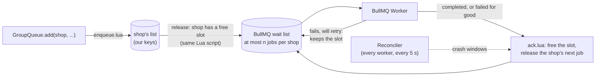

# @sparq/bullmq-groups (POC)

Per-group FIFO with round-robin fairness between groups, built on open-source BullMQ. This is the part of BullMQ Pro's groups feature we need. One shop (group) can't starve the others, a shop's jobs run in the order they were added, and at most `n` of a shop's jobs run at once.

**Status: proof of concept.** The build-vs-buy writeup lives in the "BullMQ groups POC: build vs buy" doc. This README covers the design, the guarantees and how to run things.

```ts
import { GroupQueue, GroupWorker, groupIdOf } from '@sparq/bullmq-groups';

const connection = { host: 'localhost', port: 6379 };

// Producer: the first argument is the group, e.g. the shop.
const queue = new GroupQueue('product-sync', { connection, groupConcurrency: 1 });
await queue.add(String(client.shopifyId), 'sync', { shopifyId: client.shopifyId }, { attempts: 3, backoff: { type: 'exponential', delay: 5_000 } });

// Worker: a normal BullMQ processor. Any BullMQ worker option works.
const worker = new GroupWorker('product-sync', async job => {
  const shop = groupIdOf(job); // same field as BullMQ Pro: job.opts.group.id
  await syncProducts(job.data.shopifyId);
}, { connection, concurrency: 12, lockDuration: 10 * 60_000 });

worker.on('stuck', s => logger.warn('job running too long', s)); // { jobId, groupId, state, ageMs }
```

## How it works

Waiting jobs live in a Redis list per group, not in BullMQ. A job is handed to an ordinary BullMQ queue of the same name only when its group has a free slot. That means:

- BullMQ never holds more than `n` jobs of one group, where `n` is the group concurrency.
- BullMQ's FIFO wait list therefore serves groups round-robin. When a group's job finishes, the group's next job joins the back of the wait list, behind one job from every other busy group.
- BullMQ's workers, locks, retries, backoff, stalled-job recovery, events, metrics and dashboards (bull-board) all work unchanged. The processor is passed straight to `new Worker()`, so sandboxed processors work too.



Every change that can free capacity runs inside one Lua script, and so does the release: adding a job, finishing one, resuming a group, raising its concurrency, a delayed job coming due. Two workers can never release the same job or overfill a group.

The package uses only BullMQ's public API: `Queue.add/addBulk`, `Queue.getJobState`, `Job.retry`, and the Worker's `completed` and `failed` events. It never reads or writes BullMQ's own Redis keys. The same test suite passes on BullMQ **5.81.5** (the 5.x line our backend runs) and **6.3.15** (latest): `npm test` and `npm run test:v6`.

## Why this design

The ticket listed three candidates. All three were built and benchmarked (`bench/approaches/`).

| Design | FIFO per group | Fair across groups | What it costs at 1k+ groups | Verdict |
| --- | --- | --- | --- | --- |
| Queue per group: one BullMQ queue and a concurrency-1 worker per group | Yes | Yes | One worker and one blocking Redis connection per group, on every worker process. No global concurrency limit. Each idle queue leaves ~6 keys behind. It would also need group discovery and idle-worker cleanup. | Rejected |
| One queue, group index in Lua, release a job when its group has a slot (this package) | Yes, also through retries and crashes | Round-robin | A fixed 4 connections per worker process. Idle groups cost 0 keys. About 2x plain BullMQ's Redis work per job. | Built |
| One queue, push out-of-turn jobs back with `moveToDelayed` | Only at group concurrency 1 | Poor under skew: a big group's backlog clogs the queue | Every out-of-turn pick is a wasted fetch and re-delay. Per-group gate keys are never cleaned up. | Rejected |

The ticket's second option said "the worker picks the next eligible group". This package does the same pick, but at release time instead of fetch time. Picking at fetch time would mean replacing BullMQ's fetch script (`moveToActive`), which means forking BullMQ's Lua. Releasing at most `n` jobs per group into an unmodified BullMQ gets the same ordering and fairness, and keeps every BullMQ feature.

## The POC questions, answered

| Question | Answer | Test |
| --- | --- | --- |
| Atomicity: two workers must never serve the same group | Picking a group and popping its job happen in one Lua script, inside the same script as the event that freed the slot. | `fifo-fairness`: 3 workers, 50 groups, 1,000 jobs, 0 overlaps |
| Failure and retry ordering | **Head-of-line block while retrying.** A failing job keeps its slot through all its attempts and backoff, so nothing behind it starts. After the last attempt, `failurePolicy` decides: `continue` (default: the job goes to BullMQ's failed set and the group moves on) or `block` (the group stops until `retryBlockedGroup` or `skipBlockedGroup`). BullMQ Pro does *not* hold order during retries ([pro-support #107](https://github.com/taskforcesh/bullmq-pro-support/issues/107)). | `failures` |
| Worker crash mid-job | The crashed job keeps its group's slot. BullMQ's stalled checker puts it back (at the head of BullMQ's wait list) and it reruns before anything behind it in the group. | `crash`: real `SIGKILL` of a worker process |
| Empty-group cleanup and the last-pop/new-job race | An idle group has 0 keys. Redis drops empty lists, and index entries are removed in the same script that empties them. "Last job finished" and "new job arrived" are each a single script, so they can't interleave. | `lifecycle`: cleanup test, and a 3 s random race test |
| Fairness under skew | BullMQ holds at most `n` jobs of the big group, so the small groups' jobs sit right behind them in the wait list. | `fifo-fairness` skew test, `bench` skew scenario |
| Delayed and priority jobs | A delayed job joins the **tail** of its group when it comes due, like BullMQ moving a due job to the end of its wait list. Priority orders jobs *inside* a group with BullMQ's rules: jobs without a priority first, then lower numbers first. Released jobs carry no BullMQ priority, so a priority job never jumps ahead of other groups. | `lifecycle` |
| Graceful shutdown, deploy mid-drain, pausing one group | `close()` waits for running jobs and their bookkeeping, so each group's next job is already in BullMQ for the new pod. `pauseGroup`/`resumeGroup` apply on every worker; running jobs finish. | `lifecycle` |
| Redis memory, key count, TTLs | About 1 key per group with waiting jobs, 0 per idle group, plus a fixed handful per queue. No TTLs are needed because cleanup is deterministic. BullMQ's `removeOnComplete`/`removeOnFail` still govern finished jobs. A waiting job costs less memory than in plain BullMQ, because it is a list entry plus one hash field instead of a full job hash. | `bench` memory scenario |
| Reconnect and failover | Every script is safe to run twice (ioredis resends unanswered commands after a reconnect). A reconciler repairs anything a crash or failover leaves half-done. | `reconnect`: every connection killed 3 times mid-run, no job lost, duplicated, reordered or overlapped |
| Observability | `getStats()`, `getGroups()` (most-behind first, with lag), `getGroupCounts()`, `getStuckJobs()`, and `stuck`, `blocked` and `repaired` events. | `observability` |

## Crash windows and the reconciler

BullMQ's scripts and ours are separate Redis calls, so a process can die between them. Every `GroupWorker` runs a reconciler every 5 s (it can also be run from a cron). It checks each released job older than the grace period (`reconcileGraceMs`, default 30 s) against `Queue.getJobState`:

| What happened | What the reconciler sees | What it does |
| --- | --- | --- |
| Process died after releasing a job, before adding it to BullMQ | release not confirmed, BullMQ: unknown | Adds it to BullMQ. It has the same job id, so this is harmless if the add did land. |
| Died after the add, before confirming it | not confirmed, BullMQ: waiting/active | Confirms it. |
| Worker died after BullMQ finished the job, before the group was told. Also: BullMQ threw `Missing lock` on a completion resent after a reconnect and never emitted `completed` (5 jobs in the reconnect test) | confirmed, BullMQ: completed/failed or unknown | Frees the slot and releases the group's next job. |
| Someone removed the job from a dashboard | confirmed, BullMQ: unknown | Same as above. |
| A group has a free slot and waiting jobs, but nothing released them (default concurrency changed, or writes lost in a failover) | the `kick` pass over the group index | Releases them and emits `repaired`. |
| A job has been in flight longer than `stuckAfterMs` (default 15 min) | BullMQ: active/waiting/delayed | Emits `stuck`. |

Delivery is **at least once**, the same as BullMQ itself. One case can still run a job twice: a release whose BullMQ add was delayed past the grace period, for example by a 30 s GC pause, and that then also lands after the reconciler re-added it. A Redis failover can lose the last writes, but BullMQ's state and ours live in the same Redis and are lost together, so the reconciler reconciles them like any crash.

## Semantics in detail

- **Ordering.** At group concurrency 1, a group's jobs start and finish strictly in order. At concurrency `n`, jobs are released strictly in order, at most `n` at a time. Up to `n` consecutive jobs then run concurrently and may start in any order among themselves. No system can do better: once `n` jobs are in flight, workers race. A BullMQ 6 test run caught an earlier test that assumed otherwise.
- **Concurrency.** `groupConcurrency` is the queue default and is stored in Redis. `setGroupConcurrency(group, n | null)` overrides it for one group, like Pro's local group concurrency. Worker `concurrency` stays BullMQ's per-process limit across all groups.
- **Job ids.** Adding a job id that is still waiting or running in its group is a no-op (`status: 'duplicate'`). Once it finished, the id can be reused. Generated ids look like `g<process><time><counter>`. Ids follow BullMQ's rules: no `:`, not an integer.
- **Options.** BullMQ job options pass through (`attempts`, `backoff`, `removeOnComplete`, ...). `delay` and `priority` are handled by the group. `repeat`, `lifo`, `parent` and `deduplication` are rejected. The BullMQ job's `timestamp` is the time it was added to the group, so existing "time to start" metrics keep measuring the whole wait.
- **`failurePolicy: 'block'`** forces `removeOnFail: false` so the failed job can be retried from BullMQ.
- **Config lives in Redis.** `groupConcurrency`, `failurePolicy` and `reconcileGraceMs` are written to the queue's meta hash by whoever passes them, so set them the same everywhere (or only in one place).

## Redis keys

All keys sit under the BullMQ queue's prefix (`bull:<queue>:gq:`), so a hash-tagged prefix keeps them in one Redis Cluster slot:

| Key | Type | Holds |
| --- | --- | --- |
| `w:<group>` | list | the group's waiting jobs, FIFO (`readyAt:jobId`) |
| `p:<group>` | zset | the group's prioritized waiting jobs |
| `groups` | zset | groups with waiting jobs → when their next job became ready (drives lag metrics) |
| `active` | hash | group → jobs in flight |
| `inflight`, `checks` | hash, zset | released jobs not yet finished, and when the reconciler should look at them |
| `data` | hash | payloads of waiting jobs. Dropped once BullMQ has the job. |
| `delayed`, `dmeta` | zset, hash | delayed jobs not yet due |
| `paused`, `conc`, `blocked` | set, hash, hash | per-group settings and blocks. These are config, so they stay until changed. |
| `meta` | hash | queue settings and counters |

## Observability

```ts
await queue.getStats();
// { waitingGroups, activeGroups, waiting, inflight, delayed, pausedGroups, blockedGroups, oldestWaitingMs }
await queue.getGroups(0, 19);           // 20 most-behind groups: { id, lagMs, waiting, active }
await queue.getGroupCounts('shop-123'); // { waiting, prioritized, active, concurrency, paused, blockedJobId, headReadyAt }
await queue.getStuckJobs(15 * 60_000);
```

Alerts worth having: `oldestWaitingMs` above a threshold (a shop is falling behind), `blockedGroups > 0` under `failurePolicy: 'block'`, and any `stuck` or `repaired` event. `queue.bull` is the underlying BullMQ queue, so existing BullMQ metrics and bull-board keep working. They just show at most `n` jobs per group.

## Benchmarks

See [bench/RESULTS.md](bench/RESULTS.md) for every number and its setup. Headlines on a laptop (i5-11320H, Redis 7.4 in Docker):

| | Plain BullMQ | This package | Queue per group | Delay out-of-turn jobs |
| --- | ---: | ---: | ---: | ---: |
| 999 one-job shops queued behind one shop's 20,000 jobs: time until all are done | 12.3 s | **0.6 s** | 1.0 s | 2.4 s |
| Jobs of the same shop running at the same time, 1,000 jobs/s for 30 s | 113 | **0** | 0 | 0 |
| Same, 3,000 jobs/s | 1,228 | **0** | not run | not run |
| Add-to-start latency p99, 1,000 jobs/s, 5 ms jobs | 3 ms | 3 ms | 6 ms | 3 ms |
| Add-to-start latency p99, 3,000 jobs/s | 5 ms | 9 ms | not run | not run |
| Drain throughput, one worker process, no-op jobs | 18,587/s | 7,138/s | 9,515/s | 12,430/s |
| Redis CPU per 1,000 jobs, add + run | 76 ms | 152 ms | 103 ms | 94 ms |
| Redis commands per job in the skew run | 23 | 41 | 50 | 616 |
| Redis memory per waiting job (100k jobs, 10k groups) | 629 B | **374 B** | 1,095 B | not run |
| Redis keys while 100k jobs wait in 10k groups | 100,005 | 20,011 | 150,000 | not run |
| Redis keys left after draining 1,000 groups | 4 | 5 | 6,258 | 1,004 |
| Redis connections for 1,000 groups | 4 | 7 | 1,002 | 5 |

Queue per group was not run at 10,000 groups: it needs a worker and a blocking connection per group, and at 3,000 groups it already drained at only 2,141 jobs/s with 3,002 connections. The price of strict order: a shop with a 20,000-job backlog runs one job at a time (four at concurrency 4), where plain BullMQ runs 20 of them at once.

## Not built (yet)

- **Per-group rate limit.** This is the next Pro feature we might want, since Shopify limits are per shop. Sketch: a token bucket checked in `release()`, plus a delayed kick when a group is limited.
- **Max group size, batches, observables.** Not needed today.
- **Listing or removing a group's waiting jobs.** Easy to add.
- **Redis Cluster.** Untested. Keys share the queue prefix, so a hash-tagged prefix should be enough.
- **Per-job overhead.** About 2x plain BullMQ's Redis CPU per job. The main lever is batching acks and releases, which this POC does not do.
- **Production notes.** BullMQ rate-limits stalled checks with a key whose TTL comes from the worker that set it. A deploy with a long `stalledInterval` can delay crash recovery for every worker, and the SIGKILL test hit exactly this. With our current `lockDuration`/`stalledInterval` of 10 minutes, a crashed job holds its shop for up to ~20 minutes.
- **NestJS.** `@nestjs/bullmq`'s `@Processor` creates its own Worker. A `GroupWorker` would be registered through a small custom provider instead.

## Running it

```bash
npm install
docker compose up -d        # Redis on 127.0.0.1:6390, persistence off
npm test                    # 25 tests against BullMQ 5.81.5 (~70 s)
npm run test:v6             # the same tests against BullMQ 6.3.15 in a temp copy
bash bench/all.sh           # whole benchmark matrix (~15 min). FLUSHES the Redis at port 6390.
npx tsx bench/report.ts     # bench/results/*.json -> bench/RESULTS.md
```

```
src/
  group-queue.ts      producer, admin and observability API
  group-worker.ts     BullMQ Worker + acks + reconciler + delayed promotion
  lua/*.lua           enqueue, ack, markAdded, promote, control, lease, kick (+ shared helpers)
test/                 node:test suites, one per concern
bench/                runner, four approaches, results and report
```
