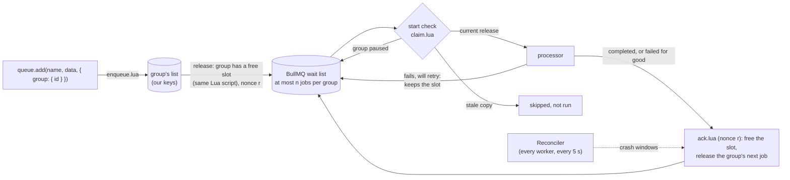

# Concepts

How the package produces per-group FIFO and cross-group fairness on unmodified BullMQ.

## The core idea

Waiting jobs do not live in BullMQ. They live in a Redis list per group, and a job is handed to BullMQ's ordinary wait list only when its group has a free slot.

Everything follows from that one move:

- BullMQ never holds more than `n` jobs of one group, where `n` is the group concurrency.
- BullMQ's FIFO wait list therefore serves groups **round-robin**. When a group's job finishes, its next job joins the back of the wait list, behind one job from every other busy group.
- BullMQ's locks, retries, backoff, stalled-job recovery, events and metrics all work unchanged, because `GroupQueue`, `GroupWorker` and `GroupJob` are subclasses of BullMQ's own classes. Function and sandboxed processors both work.

With **no** per-group limit (Pro's default), a group keeps exactly one released job waiting in BullMQ — its turn. When that job starts, the next is released behind every other group's turn. Any number of the group's jobs run at once, and they start in the order added.

## Releases and the nonce

Every release carries a **nonce**, which travels with the BullMQ job as `job.opts.group.r`.

The nonce identifies *a release*, not a job. That distinction is what makes the system safe against a class of bugs that job ids alone cannot cover:

- a command resent by ioredis after a reconnect
- a late `Queue.add` whose reply was lost
- a job id reused after the original finished

Every script that confirms or finishes a job acts only on the release it belongs to. A stale nonce is a no-op rather than a slot freed twice.

## The start check

Before a processor runs, the worker confirms the job is the release its group is actually waiting for. This hooks BullMQ's protected `Worker.callProcessJob`.

| Verdict | What happens |
| --- | --- |
| current release | the processor runs |
| stale copy | skipped, not run, removed from BullMQ, `skipped` event |
| group paused | returned to the wait list, re-checked every `recheckMs` (5 s) |

It costs one round trip per job start.

## Atomicity

Every change that can free capacity runs inside **one Lua script**, and the release happens in that same script: adding a job, finishing one, starting one (for a group with no limit), resuming a group, raising its concurrency, a delayed job coming due.

Two workers can never release the same job or overfill a group, because picking a group and popping its job are not separable steps.

## What it touches in BullMQ

The package uses BullMQ's public API — `Queue.add/addBulk/getJob`, `Job.retry/remove/moveToDelayed`, `Worker` events — plus three protected extension points:

| Extension point | Used for |
| --- | --- |
| `Worker.callProcessJob` | the start check |
| `Job.validateOptions` | rejecting options a grouped job cannot take, before the job is stored |
| the `Job` class getter | so queues and workers hand out `GroupJob`s |

Its own scripts read exactly one BullMQ key: a job's hash, to learn whether the job exists and which nonce its options carry.

The same 77 tests pass on BullMQ 5.40.0 (oldest supported), 5.67.1, 5.81.5 and 6.3.15.

## Why this design

Three designs were built and benchmarked (`bench/approaches/`).

| Design | FIFO per group | Fair across groups | Cost at 1k+ groups | Verdict |
| --- | --- | --- | --- | --- |
| **Queue per group** — one BullMQ queue and a concurrency-1 worker each | Yes | Yes | One worker and one blocking Redis connection per group, on every worker process. No global concurrency limit. ~6 keys per idle queue. Needs group discovery and idle-worker cleanup. | Rejected |
| **Group index in Lua, release when the group has a slot** (this package) | Yes, also through retries | Round-robin by turns | 4 Redis connections per queue per worker process once the queue has group jobs (BullMQ's 2 plus ours), against 2 for plain BullMQ. 0 keys per idle group. ~2.5x plain BullMQ's Redis CPU per job. | **Built** |
| **Push out-of-turn jobs back with `moveToDelayed`** | Only at concurrency 1 | Poor under skew — a big group's backlog clogs the queue | Every out-of-turn pick is a wasted fetch and re-delay. Per-group gate keys are never cleaned up. | Rejected |

A fourth option is to let the worker pick the next eligible group when it *fetches*. This package makes the same pick at *release* time instead, because picking at fetch time means replacing BullMQ's `moveToActive` — forking BullMQ's Lua, and inheriting its maintenance forever.

Releasing at most `n` jobs per group into an unmodified BullMQ gives the same ordering and fairness. It costs two things, both documented in [Known limits](./production.md#known-limits): priority cannot reorder a job already released, and order at group concurrency `n` > 1 is only kept within a window of `n`.

## Ordering, precisely

| Group concurrency | Guarantee |
| --- | --- |
| `1` | jobs start **and finish** strictly in order, through retries and crash recovery |
| `n` > 1 | released in order, at most `n` at a time; up to `n` consecutive jobs run at once in any start order |
| unset (no limit) | jobs **start** in order; any number run at once |

At concurrency `n`, a retrying or crashed job holds only its own slot, so later jobs overtake it through the other `n`-1. Once `n` jobs are in flight, no system can do better than that window.

## Job options

BullMQ job options pass straight through — `attempts`, `backoff`, `removeOnComplete` and the rest — and BullMQ's own option checks run when the job is added, via `Job.validateOptions`.

The queue's `defaultJobOptions` apply too, minus the ones a grouped job cannot take.

| Option | Handling |
| --- | --- |
| `delay` | handled by the group: the job joins its group's tail when due |
| `group.priority` | orders jobs still waiting **within** the group |
| `priority` (top level) | **rejected** for grouped jobs |
| `repeat`, `lifo`, `parent`, `debounce` | **rejected** for grouped jobs |

Job schedulers therefore need a small fan-out job that calls `queue.add(..., { group })`.

The BullMQ job's `timestamp` is the time it was added **to the group**, not the time it was released, so existing "time to start" metrics keep measuring the whole wait.

## Job ids and deduplication

Adding an id that is pending or running in its group, or that BullMQ still holds (a finished job kept by `removeOnComplete` / `removeOnFail`), is a **no-op that returns a job with that id** — as in BullMQ.

`deduplication: { id }` works like BullMQ's simple mode: while a job added with that id is pending or in flight, another add with the same id returns the first job's id. The `ttl`, `extend` and `replace` modes are **not** supported.

Generated ids look like `g<process><time><counter>`. Ids follow BullMQ's rules: no `:`, not an integer, not one of BullMQ's key names.

Because ids can be reused once a job has finished, the [nonce](#releases-and-the-nonce) — not the id — is what identifies a release.

## Plain jobs and BullMQ's own methods

A job added without `group` runs without a group slot, on the same queue.

| Method on `GroupQueue` | Sees jobs waiting in a group? |
| --- | --- |
| `getJob()`, `remove()`, `drain()`, `obliterate()` | **Yes** |
| `getGroupJobs()`, `getGroupsJobsCount()` | Yes — that is what they are for |
| `clean()`, `getJobCounts()`, `getWaiting()`, BullMQ's other getters | **No** — only jobs BullMQ holds |

Removing a released job that BullMQ holds — `queue.remove()` or `job.remove()` — frees its group slot at once. After `drain()`, the workers' reconcilers free the drained releases on their next pass.

During a migration, move a queue to `GroupWorker` under a **new queue name**: an old plain worker would take released jobs without acking them, holding each group for a grace period. See [Production](./production.md#1-a-plain-bullmq-worker-on-a-grouped-queue).

## Configuration lives in Redis

A `GroupWorker` writes `group.concurrency`, `group.failurePolicy` and `reconcileGraceMs` to the queue's meta hash when it starts.

- Unset values are written as the defaults (no limit, `continue`), so **removing** an option from `group` takes effect on the next deploy. `group: {}` resets both.
- Producers release jobs by what is stored. Until a worker has written anything, a group has no limit.
- A worker created **without** `group` options never writes `group.concurrency` or `group.failurePolicy`. It writes `reconcileGraceMs` only when given one. So a second app, or a NestJS processor without `group`, serves grouped jobs by what the queue's other workers wrote and cannot change them — and a plain queue stays plain.
- If Redis loses the meta hash (a flush, a failover to an empty replica), running processes fall back to the defaults until a worker restarts.

This is why [Production](./production.md) insists that every worker of a queue declaring `group` options declares the **same** ones: the last worker to start wins.

## Redis keys

All keys sit under the BullMQ queue's prefix, as `bull:<queue>:gq:`, so a hash-tagged prefix keeps them in one Redis Cluster slot.

| Key | Type | Holds |
| --- | --- | --- |
| `w:<group>` | list | the group's waiting jobs, FIFO (`readyAt:jobId`) |
| `p:<group>` | zset | the group's prioritized waiting jobs |
| `groups` | zset | groups with waiting jobs → when their next job became ready (drives lag metrics) |
| `active` | hash | group → jobs in flight |
| `turn` | hash | group with no limit → its released job that has not started yet |
| `inflight`, `checks` | hash, zset | released jobs not yet finished, with their nonce, and when the reconciler should look |
| `data` | hash | payloads of waiting jobs; dropped once BullMQ has the job |
| `delayed`, `dmeta` | zset, hash | delayed jobs not yet due |
| `dedup`, `jdedup` | hash, hash | deduplication id ↔ job, while pending or in flight |
| `blocked`, `b:<group>` | hash, list | groups blocked under `failurePolicy: 'block'`, and their failed jobs |
| `paused`, `conc` | set, hash | per-group settings — config, so they persist until changed |
| `meta` | hash | queue settings and counters |

An idle group costs **0 keys**. Redis drops empty lists, and index entries are removed in the same script that empties them. No TTLs are needed because cleanup is deterministic.

## Next

- [Guarantees](./guarantees.md) — crash windows, the reconciler, delivery semantics
- [Production](./production.md) — settings, observability, limits
- [API reference](./api/README.md)
